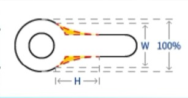
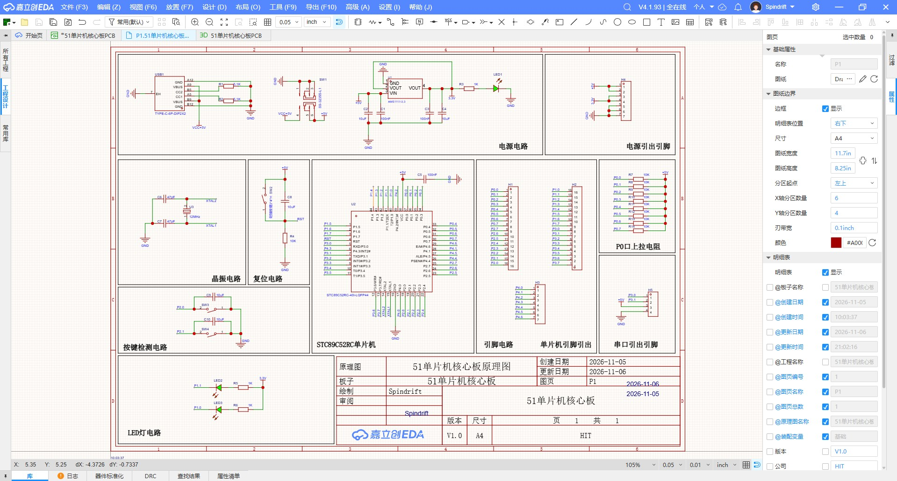
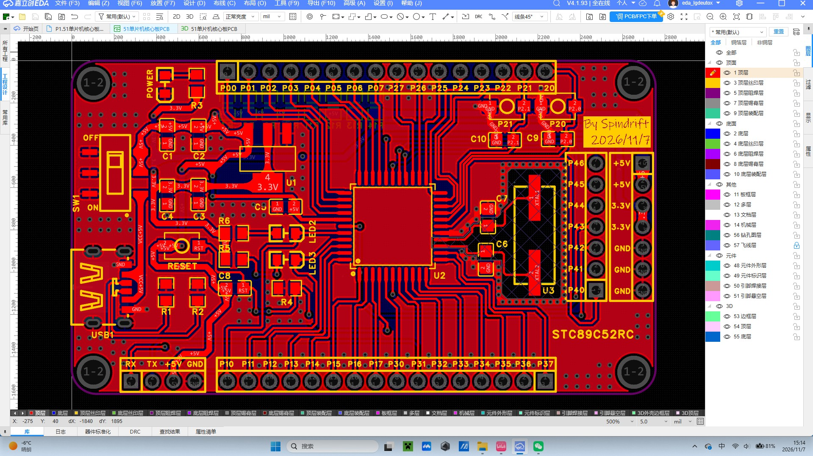
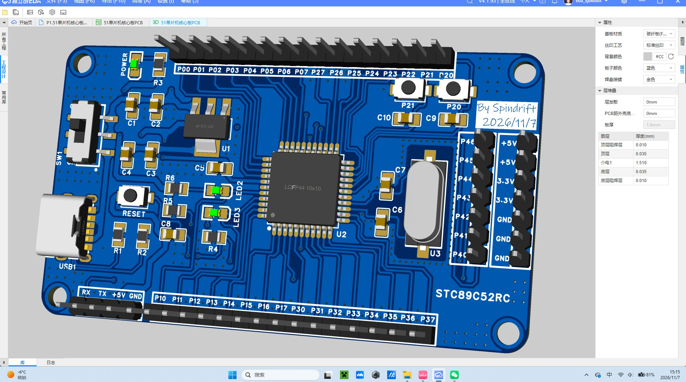

# PCB设计

## PCB实战绘制

PCB布局要求  

通用要求合理安排布局，元器件之间应相互平行或者垂直排列，以求整齐、美观;元件排列紧凑，在整个版面上应分布均匀、疏密一致，所有元器件均放置在预层。（大批量生产时顶层合适）  

1. 必须根据元器件的电气特性和使用特点来布局(这点非常重要)，举例如下:对于各种接口、按键和排针，需要放在板子边缘，方便插接，对于屏幕和主控芯片等，一般放在板子中央，对于电源电路，一般放在板子的电源输入旁边并且要注意电流路径和滤波电容位置(非常重要)，吋于晶振需要靠近单片机晶振引脚摆放等  
2. 不要把元器件看成二维物体，而是应该看成三维物体，有时空间有干涉的情况需要考虑  
3. 元件的布局应该采用模块化，也就是同一个模块电路的元件应该放同一个区域，按照就近原则来布局，不能东一个西一个  

PCB布线要求  

⭕⭕⭕不要使用自动布线！！！！！！！  

1. 顶层优先原则:尽量在顶层布线  
2. 电源线原则上要加粗:因为电源线是要给电路板各个模块供电的，电源线加粗有利于电流在主干道上流通;在日常PCB设计中，在25°C时，对于铜厚为10z(盎司)的导线，10mil线宽能够承载0.65A电流，40mil线宽能够承载2.3A电流。  
3. 同一层内走线大于90“:同一层走线禁止90°或者走锐角，从原理上讲，锐角直角走线会造成走线阻抗不连续，对于信号的传输有影响，推荐走线135°  
4. 注意电流路径和电容的摆放位置:电源要先经过电容滤波再给后级，去耦电容要贴近芯片引脚放置，并就近接地。  
5. 高频信号线尽可能短，并做好与其他信号的屏蔽隔离。为了降低相邻走线之间的串扰，尽量避免相邻层平行走线，走线应遵循3W原则:相邻层信号线应采用正交方问。差分线布线尽量等距等长。  
- 🔸3W原则：两条线之间的间距大于三倍的线宽  
6. PC日布线要尽量远离安装孔与电路板边缘:在PC日钻孔加工中，很容易会切掉一部分导线，为了电路板功能，应尽量远离这些位置。
7. 需要添加泪滴。  
  

*图 泪滴-图中黄色部分*  

PCB布线顺序  

🔺关键元件优先、关键信号线优先、密度优先
1. 密度优先原则:从单板上连线最密集的区域开始布线。  
2. 优先关键元器件:如DDR、射频等核心部分应优先布线，类似信号传输线应提供专层、电源、地回路。其他次要信号要顾全整体，不可以和关键信号相抵触。  
3. 关键信号线优先:电源、模拟小信号、高速信号、时钟信号和同步信号等关键信号优先布线。

成品：C51单片机（STC89C52RC）  
  

*图 电路原理图*  

  

*图 PCB绘制图*  

  

*图 3D展示成品图*  
