# PCB设计

## PCB设计基础-PCB结构与组成  

PCB板就是印制电路板，又称印刷电路板，是电子元器件电气连接的提供者。  
PCB根据其基板材料的不同而不同，高频微波板、金属基板，铝基板、铁基板、铜基板、双面板及多层板PCB是英文*Printed Circuit Board*的缩写，中文名称为印制电路板，又称印刷电路板、印刷线路板，是重要的电子部件。  
1. 导线：  
导线(Track)具有和原理图对应的网络连接关系  
导线带有网标(NetLable)，对应电路图结点在布线时，导线可以被自动推挤、环绕等通常用于信号的布线。  
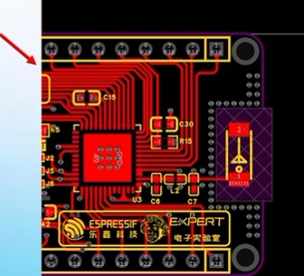  

*图1 导线（图中红色的线）*  

2. 铺铜：  
通过一整块铜皮对网络进行连接，通常用于地(GND)和电源(POWER)  
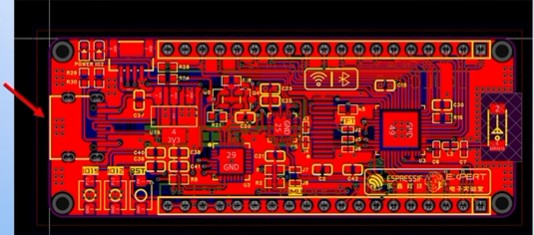  

*图2 铺铜（大面积红色区域）*  

3.  过孔：  
1.电气连接:过孔用于将不同层面的电路连接起来，使得电路板能够在不同的层次上进行有效的信号和电源传输。  
2.器件固定或定位:过孔还可以用作固定电子部件的位置，如电阻、电容等，确保其在电路板上的正确布局。
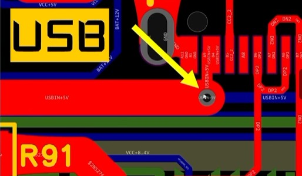  

*图3 过孔，蓝色为底层，红色为顶层*  

过孔的类型：  
通孔:最常见和最简单的PCB过孔是通孔过孔。通孔是从PCB的上层钻到底层的机械钻孔。  
盲孔:盲孔是激光钻孔的一种，是从PCB的上层或底层到内层钻孔和电镀的孔。  
埋孔:埋孔可以是激光钻孔也可以是机械钻孔，指位于印刷线路板内层的连接孔，它不会延伸到线路板的表面。  
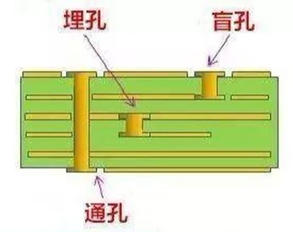  

*图4 不同的过孔类型*    

4. 焊盘：  
元件通过PCB上的引线孔，用焊锡焊接的方式固定在PCB上，印制导线把焊盘连接起来，实现元件在电路中的电气连接。引线孔及周围的铜箔称为焊盘。  
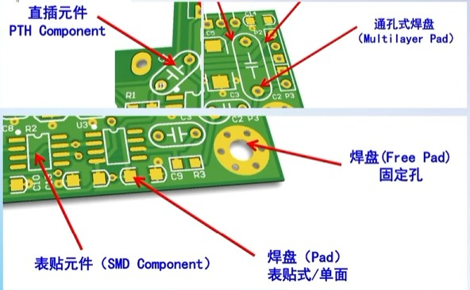  

*图5 不同焊盘*  

5. 丝印：  
PCB丝印是指在电子线路板(Printed CircuitBoard)上印刷的信息，如文字、标志、图形等。这些丝印具有重要的功能，它们可以帮助标识电子元件的位置、数值、型号等信息，以及元件的方问和正确的安装方式。  
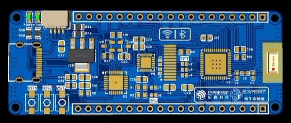  

*图6 丝印*  

6. 阻焊： 
在铜层上面覆盖油墨层，油墨层覆盖住铜层上面不需要焊接的线路，防止PCB上的线路和其他的金属、焊锡或者其它的导电物体接触导致短路，起到绝缘顶保护铜层作用，选择性露出焊接需要的铜PAD、IC等。  
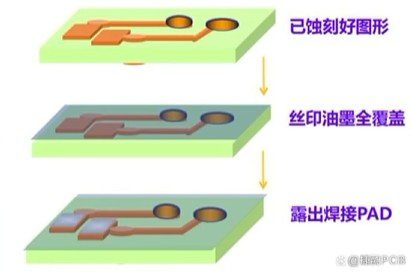  

*图7 阻焊*  

## PCB设计基础-PCB叠层结构  

PCB材料的组成主要有PP半固态片和Core芯板两部分组成，这就构成了所看到的绿色、红色或者黑色等的板子，再加上敷铜线路层，器件，就构成了电路板。  
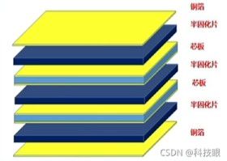  

*图8 PCB叠层结构*  

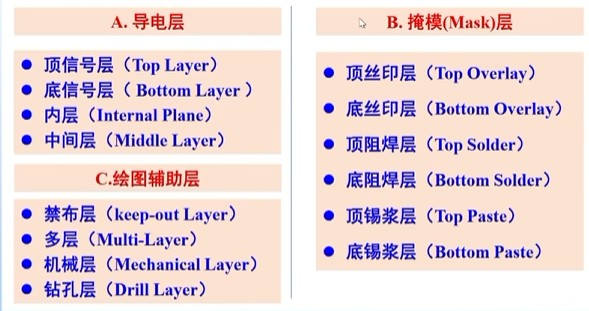  

*图9 立创EDA中的图层*  

## PCB设计基础-元件符号与封装  

1. 在PCB设计中要用到的就是元件的符号与封装，其中元件符号是在原理图放置元件阶段用到的，而元件的封装是在PCB设计阶段用到的。  
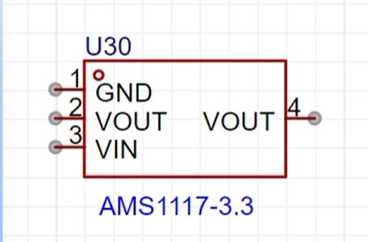  

*图10 元件符号*  

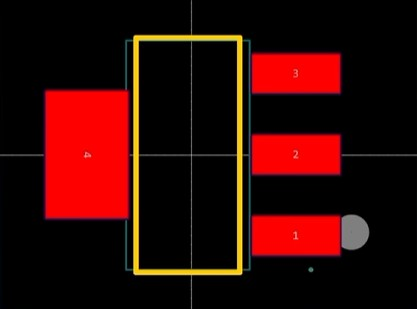  

*图11 封装图*  
其中，在元件符号左上角`GND`上方的小圆圈代表1号引脚，在封装上的小圆点对应的就是元件符号的1号引脚，放置及焊接的时候要对应。  

## PCB设计基础-PCB设计流程  

原理图设计——>布局布线——>PCB设计——>生产加工——>焊接组装  
- 设计流程：  
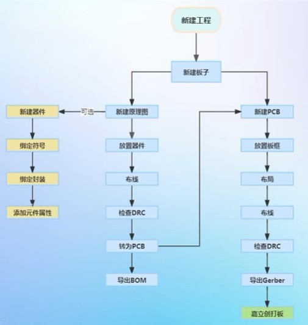  

*图12 设计流程*  
DRC(Design Rule Check)设计规则检查是一种用于确保电子设计满足特定制造工艺要求的质量保证措施。
