# PCB设计

## 电路分析基础  
- 什么是电路图  
电路图就像地图一样，可以标记实物的内容，有了电路图就可以看出对应的PCB板用了哪些模块、模块具有什么功能。  
在PCB设计领域一般不降其称为电路图，而称为原理图(Schematic Diagram)，所有的原理图都是由四要素组成的：————<u>元件符号、连接线、结点、注释</u>在把这四要素了解清楚之后，一张原理图的大概功能也就会看懂了。  

## 电路分析基础-基本原件
- 常见的元件符号主要有电阻、电容、电感、二极管、三极管、场效应管这些原件，了解这些原件是分析电路的一个基础。  
Ⅰ.电阻原件：是绘制电路图中最常用的原件之一，其在嘉立创的基础库中可找到  
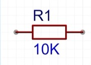  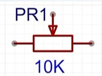  

*图1  固定电阻* | *图2  可变电阻/电位器*  
在电阻符号上方有`R1`标识，其中，`R`是电阻英文单词`Resistor`的第一个首字母，而`1`表示这个电阻原件的序号，`R1`共同构成了这个电阻符号的位号；电阻下方有`10K`标识，这个值叫做电阻元件的Value值，也就是其大小。  
- 电阻的读数：  
插接电阻：四条杠电阻与五条杠电阻  
四条杠类型：前两道杠代表电阻实际的数值，第三道杠代表电阻的乘数，第四道杠代表电阻的误差。图中为`23 x 1 = 23Ω`  
五条杠类型：前三道杠代表电阻实际的数值，第四道杠代表电阻的乘数，第五道杠代表电阻的误差。图中为`470 x 0.1 = 47Ω`  
贴片电阻：一般会在封装上打上一些数字，根据这些数字即可进行读数，其分为三位电阻和四位电阻。  
3位读数:前2位为有效数字，第3位表示10的n次幂(也可以理解为0的个数)。精度为±5%。  
4位读数:前3位为有效数字，第4位表示10的n次幂(也可以理解为0的个数)。读法和3位的原理一样，精度为±1%。  
阻值小于10的读数:通常在两个数之间插入一个字母R，用字母R来代替小数点。  
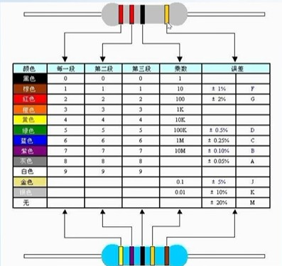  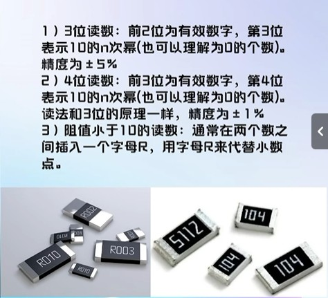  

*图3  插接电阻* | *图4  贴片电阻*  
Ⅱ.电容原件：  
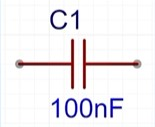  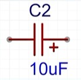  

*图5  无极性电容* | *图6  有极性电容*  
在电容符号上方有`C1`标识，其中，`C`是电容英文单词`Capacitor`的第一个首字母，而`1`表示这个电容原件的序号，`C1`共同构成了这个电容符号的位号；电容下方有`100nF`标识，这个值叫做电容元件的Value值，也就是其大小。  
🔺电容有一个非常重要的特性————<u>通交流隔直流</u>，在电容中往往起到的作用是储能和滤波，在电路中遇见电容要对电容的作用进行具体的判断和分析。  
实际的电容是有不同的类型，根据封装的形式不同可分为贴片电容和插件电容，对于不同的电容我们需要注意的是其电器特性的不同：  
🔸比如对于MLCC它在中高频段的滤波特性比较好，而它的容值普遍较低；对于钽电容和铝电解电容，其容值一般比MLCC要高，但是在高频段的滤波效果没有MLCC好，所以钽电容和铝电解电容一般用于中低频段的滤波。  
在实际进行滤波电路的设计过程中，往往会将多个类型的电容器进行一个并联，以达到1+1>2的目的，需要格外注意的事项：  
🔺有的电容是无极性的，也就是说不管正着焊接还是负着焊接，都无所谓；但是有的电容在设计的时候必须注意到其极性，比如钽电容和铝电解电容，如果在设计的时候把极性搞错，则可能会引发严重的事故。  
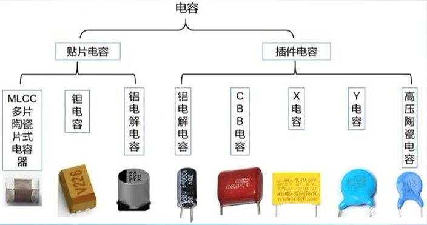  

*图7 不同类型的电容原件*
- 读取电容元件的信息：
不同于电阻原件，电容原件的封装上会标注三条比较关键的信息，分别是电容的<U>容值、正负极、耐压</u> ，如果标注的数值没有单位则默认电容的单位为微法(uF)  
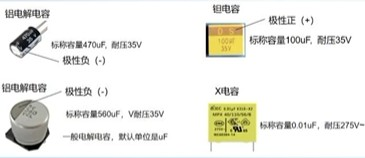  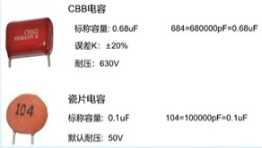  

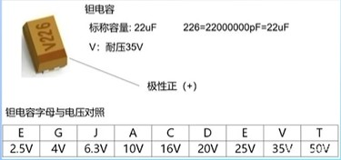  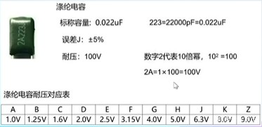  

*图 电容及其读法*  
Ⅲ.电感原件：  
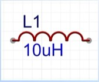  

*图8 电感原件*

在电感符号上方有`L1`标识，其中，`L`是电感英文单词`Lnductor`的第一个首字母，而`1`表示这个电感原件的序号，`L1`共同构成了这个电感符号的位号；电感下方有`10uH`标识，这个值叫做电感元件的Value值，也就是其大小。  
和电容一样，电感本身也不会消耗能量，而是将电能存储起来，所以电感也是一个动态原件，在实际的电子产品应用中，根据电感“通直流，隔交流”的特性，在电路中所起的作用主要是滤波，扼流，谐振，储能。  
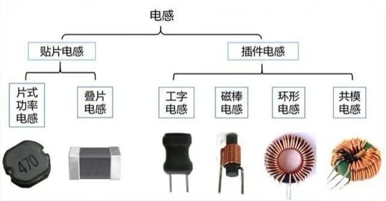  

*图9 不同类型的电感原件*  
- 电感的读取：  
对于色环电感，其读值方法和电阻一样，如果这个色环电感是四道杠，则前两位是一个有效数字位，第三位是其倍率，最后一环是它的公差。  
对于片状的功率电感，其读值方法与贴片电阻一致。  
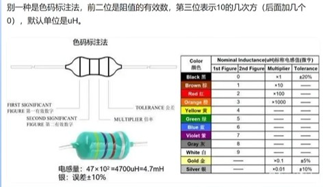  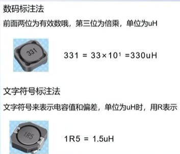  

*图10  插接电感* | *图11  贴片电感*  
Ⅳ.二极管：二极管具有单问导电性能，导通时电流方问是由阳极通过管子流向明极。  
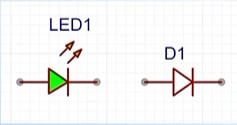  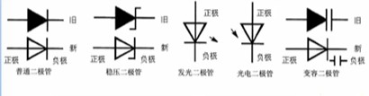  

*图12 二极管*

在左侧二极管上方有`↗↗`标识，表明这个二极管正在发光，所以是一个发光二极管，称为`LED`；在右侧的二极管并没有标识，同时有`D1`共同构成该二极管的位号，说明该二极管是一个普通二极管。  
二极管分为多种类型，其不同的二极管的电气性能和功能区别很大，另一幅图中的二极管介绍如下：  
第一个：普通二极管  
第二个：稳压二极管  
第三个：发光二极管  
第四个：光电二极管  
第五个：变容二极管  
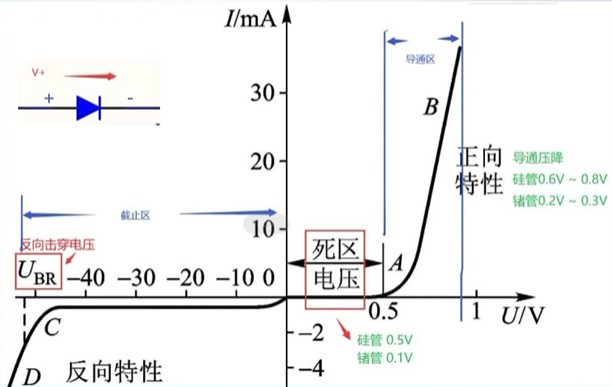  

*图13 二极管在工作时电压与电流的关系*  
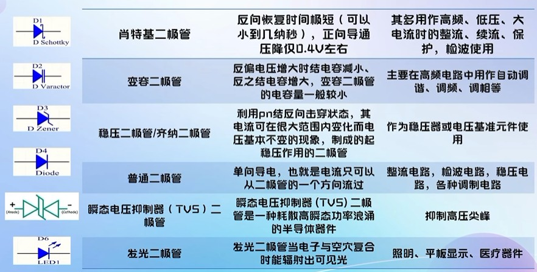  

*图14 不同类型的二极管其不同功能与其应用场景*  
Ⅴ：三极管：三极管其作用是把微弱信号放大成幅度值较大的电信号，也用作无触点开关。  
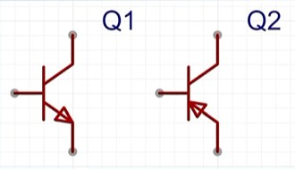  

*图15 三极管，Q1为NPN型，Q2为PNP型*  
🔺对于三极管来说有一个很重要的点：区分是NPN型三极管还是PNP型三极管，方法为看箭头的指向，箭头的指向为由P指向N，所以可得出图a为NPN型三极管，图b为PNP型三极管。  
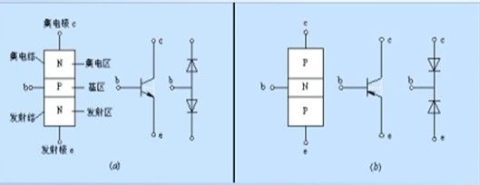  

*图16 三极管，a为NPN型，b为PNP型*  
⭕理解三极管的输出特性曲线以及应用场景：  
截止状态，发射结反偏，集电结反偏  
放大状态，发射结正偏，集电结反偏  iC=Kib  
饱和状态，发射结正偏，集电结正偏  iC≠Kib  
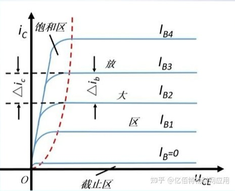  

*图17 三极管的输出特性曲线*  
三极管的应用场景：  
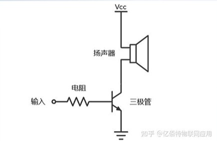  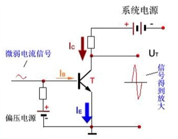  

*图18 三极管的应用场景*  
三极管的不同封装：  
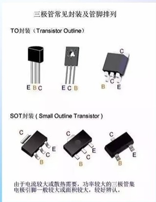  

*图19 三极管的不同封装*  
Ⅵ.场效应管：场效应晶体管(FieldEffect Transistor缩写(FET))简称场效应管。它是利用控制输入回路的电场效应来控制输出回路电流的一种半导体器件。由于它仅靠半导体中的多数载流子导电，又称单极型晶体管。场效应管属于电压控制型半导体器件。具有输入电阻高、噪声小、功耗低、动态范围大、易于集成、没有二次击穿现象、安全工作区域宽等优点。  
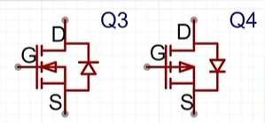  

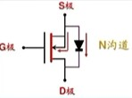  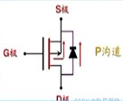  

*图20 场效应管*  
对于N沟道来说，三个引脚(S级、G级、D级)分别叫做(源极、栅极、漏极)。  
🔸对于场效应管是N沟道还是P沟道的判断方法：跟三极管的箭头一样由P指向N，
图Q3根据箭头可以得出场效应管中间的材料就是N，所以对应N沟道；图Q4根据箭头可以得出场效应管中间的材料是P，所以对应P沟道。  
- 场效应管的功能与三极管的功能比较类似  
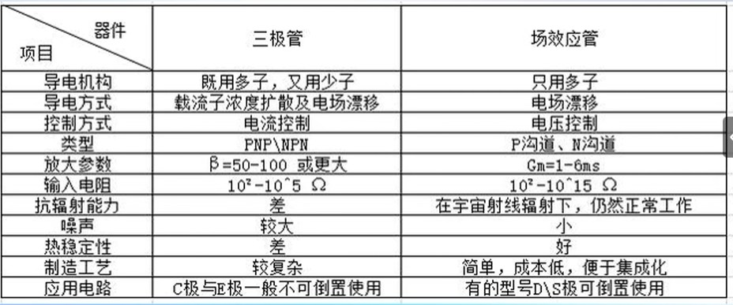  

*图21 三极管与场效应管的区别*  
⭕当用作开关时，三极管的控制量是IB，而场效应管的控制量是UGS，也就是栅极和源极之间的电压。  
不同类型的场效应管：  
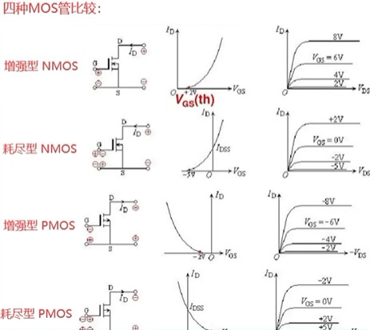  

*图22 不同类型的场效应管*  
对于不同封装的场效应管，其额定功率以及额定电压和应用场景是不同的，同时还需注意对于不同封装其管脚定义也是有所区别的：  
- SOT-23与SOT-223封装：在一些单片机开发板上面可以经常看到这种封装的场效应管，一般是用作IO口的控制  
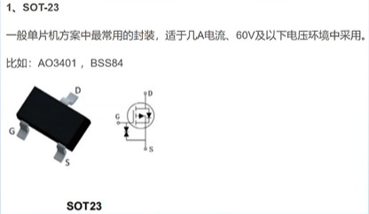  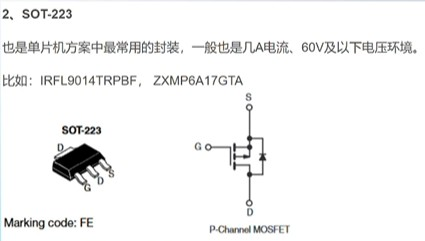  

*图23 SOT-23与SOT-223*  
- TO-252封装：  
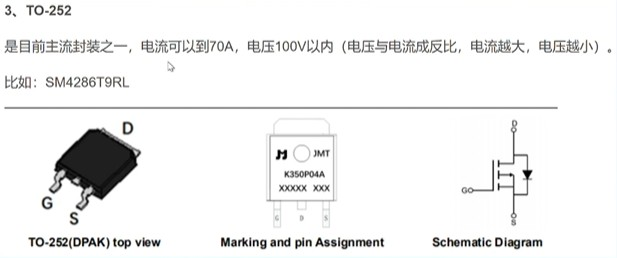  

*图22 TO-252*    
- TO-220/220F，TO-263封装：  
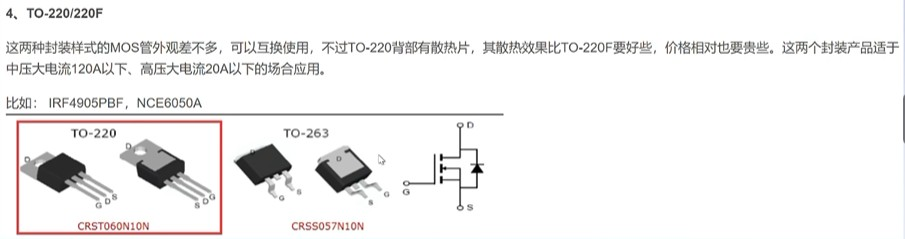  

*图22 TO-220/263*  

## 电路分析基础-元件数据手册  
- 通过元件数据手册，我们就能了解到芯片的具体功能、引脚定义、电气特性、示例应用等信息。  
1. 数据手册在哪儿找？  
1.嘉立创的立创商城页面进行搜索：https://www.szlcsc.com/  
2.半导小芯网站：https://www.semiee.com/  

## 电路分析基础-电路定理  
- 连接线：在原理图中绿色的线表示为导线，连线表示的是实际电路中的导线，在原理图中虽然只有一根线，但是在常用的印刷电路板中往往不是线而是各种形状的铜箔条、铜箔块。  
- 结点：在原理图中线与线相交的地方有红色的结点，结点表示几个元件引脚或几条导线之间相互的连接关系。所有和结点相连的元件引脚、导线，不论数目多少，都是导通的。  
- 原理图上蓝色的英文字母，名称叫做网络标签(Net Label)：网络标签表示一个电器连接点，具有相同网络标签的器件表明是电气连接在一起。  
使用网络标签可以<u>简化连线、便于理解</u>  
常用电源网络标签：  
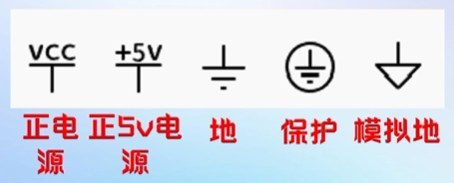  

*图23 常用电源网络标签*  
其他名词：  
1. 支路：电路中的每一分支叫做支路。支路是由一个或几个串联的电路元件构成的，是构成复杂电路的基本单元。支路是电路中通过同一电流的通路。  
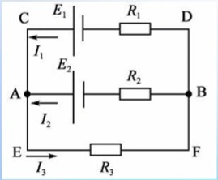  

*图23 支路*  

该图的复杂电路有AB、CD、EF三条支路。  
2. 回路：电路中任意一个闭合的路径叫做回路。在每次所选用的回路中，至少包含一个没有选用过的新支路时，这些回路叫做独立回路。  
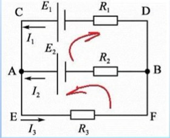  

*图24 回路*  

该图的回路有ACDBA、AEFBA、AEFBDCA三条回路，但是独立回路只能选择其中的任意两个。  
3. 网孔：不可再分的回路叫做网孔。对平面电路，其内部不含任何支路的回路称网孔。电路中的网孔数等于独立回路数。  
同*回路*图，该图只有ACDBA和AEFBA两个网孔回路  
🔹很多时候，用网孔分析电路比用回路分析电路更加方便，因为网孔是最简化的回路，同时电路中的网孔个数又等于独立回路数。  
🔺对于立体电路而言不能这样去找，需要找出不可再分回路然后才能确定网孔。  
4. 电路定理：基尔霍夫定律——基尔霍夫定律包括基尔霍夫电流定律(KCL)和基尔霍夫电压定律(KVL)。它反映了电路中所有支路电压和电流所遵循的基本规律，是分析集总参数电路的基本定律。基尔霍夫定律与元件自身的特性构成了电路分析的基础。  
集总参数电路：实际电路元件一般都和电能的消耗及电能、磁能的储存有关，它们交织在一起发生在整个元件中。一个实际元件可以用一到多个理想元件组合表示。  
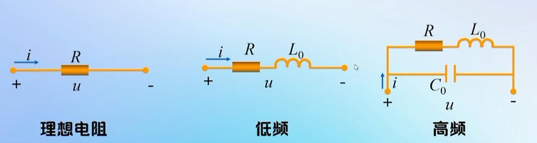  

*图25 集总参数电路图*  
理想状态：单纯的电阻器  
低频状态：此时电阻会体现出电感的特性，所以此时等效为一个电阻和一个电感的串联  
高频状态：此时电阻又会体现出电容的特性，所以此时等效为一个电阻和一个电感的串联后再和一个电容并联的模型  
在元件内部发生的一些电磁过程不仅会影响自身，同时也会影响周围的一些其他元件，特别是在一些高频电路中，这些元件之间的影响会更加明显；并不是所有电路信号都如此高，实际上大部分电路其信号频率都比较低，所以此时可以对一些元件进行理想化，假设这些电磁现象只在元件内部进行，而不会发生干扰，这样的元件即称为：<u>集总参数元件</u>。  
电磁波的公式：c = λ v  c是光速，λ是波长，v是频率  
🔸要求：用集总参数电路模型来近似地描述实际电路是有条件的，它要求实际电路的尺寸要远小于电路工作时电磁波的波长。频率越高，波长越小，所以在高频状态下无法使用集总参数模型。  
- 基尔霍夫电流定律（KCL）  
在集总参数电路中，任意时刻，财任意结点流出(或流入)该结点电流的代数和等于零。公式：∑i入 = ∑i出  
推广：KCL可以应用于电路中包围多个结点的任意闭合面  
基尔霍夫电流定律的实质：  
1.KCL是电荷守恒和电流连续性原理在电路中任意结点处的反映；  
2.KCL表示结点处立路电流间的约束，与支路上的元件性质无关；  
3.KCL方程是按电流参考方向列写的，与电流的实际方问无关。  
列KCL方程的